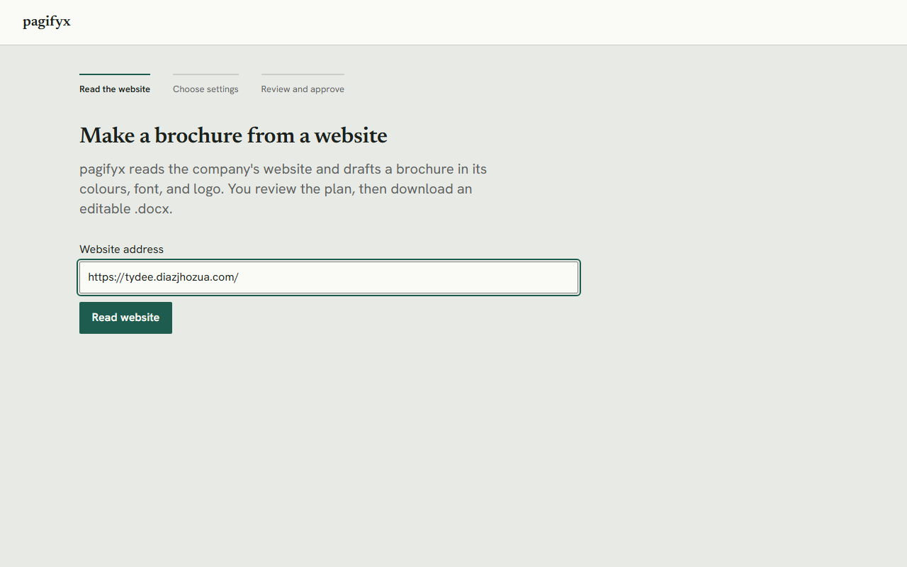
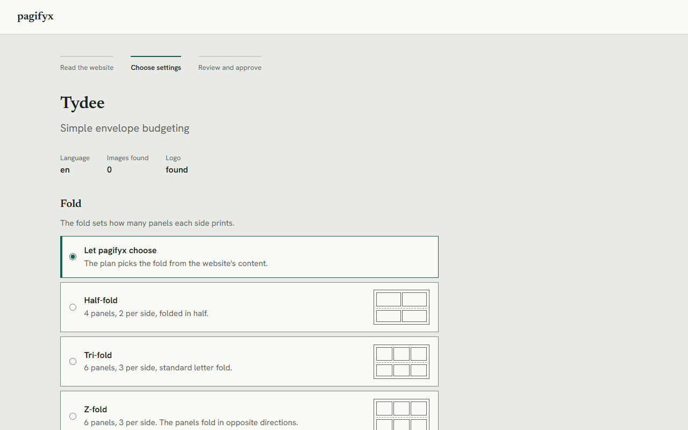
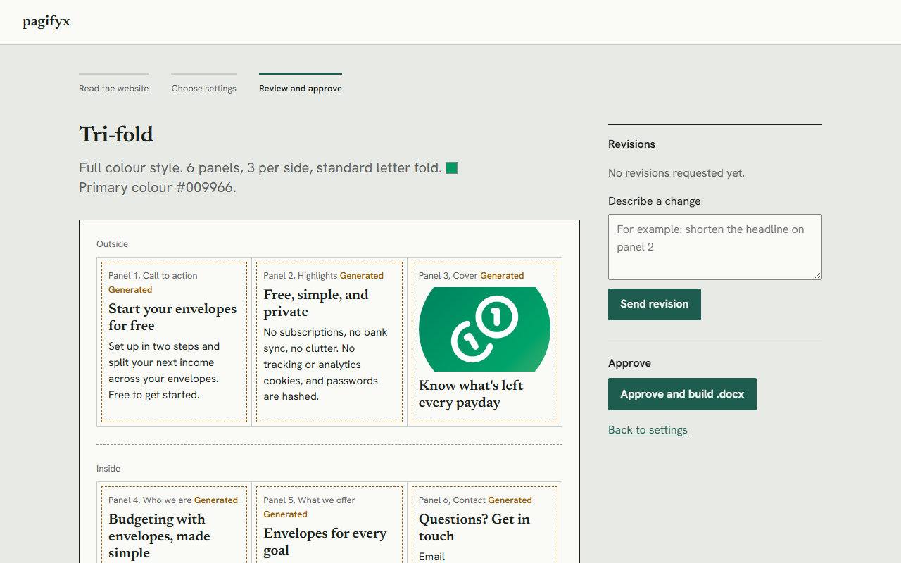
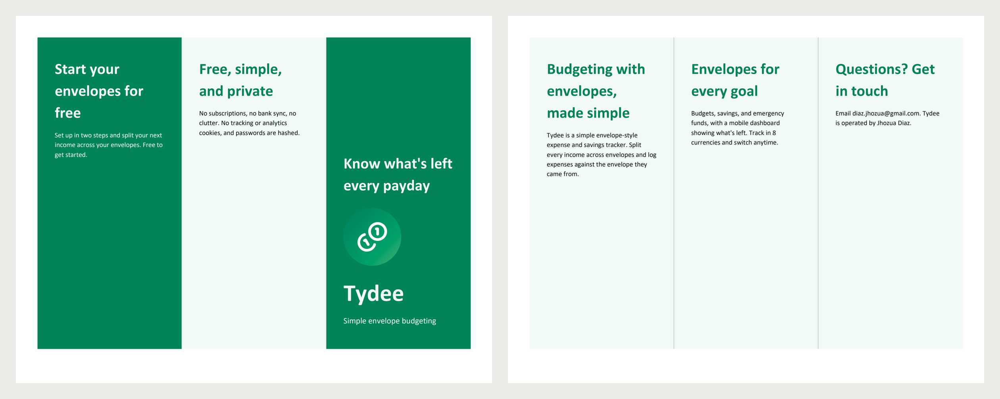

# pagifyx

## Table of Contents

- [About](#about)
- [Inspiration](#inspiration)
- [Getting Started](#getting_started)
- [Usage](#usage)
- [Limits](#limits)

## About <a name = "about"></a>

pagifyx turns an existing company website into a print-ready brochure. It reads the site, plans the brochure with an AI model, lets you revise the plan in a chat, and then writes a Word (.docx) file you can edit.

**What makes it different**

- **Built from the company's own site.** The brochure uses the site's content, theme colours, font, and logo, so it matches the company's look.
- **You review before anything is built.** Revise the plan in a chat, then approve it.
- **Editable output.** The result is a Word file, not Markdown.
- **Flagged wording.** Panels the model marks as Generated contain text that is not on the website. Check them before you print.

The screenshots below show pagifyx in use, with the Tydee website as the example. They follow the steps in order: the start page, the settings, the overview, and the Word file it produces.


*Start: paste the company's website address. pagifyx reads the site.*


*Choose settings: a fold, the brand, contact details, colours, font, and logo.*


*Review the plan as a proof sheet. Request changes in the chat, then approve.*


*The result: an editable Word brochure built from the website's own look.*

## Inspiration <a name = "inspiration"></a>

This project began in Week 1 of the Udemy course [AI Engineer Core Track: LLM Engineering, RAG, QLoRA, Agents](https://www.udemy.com/course/llm-engineering-master-ai-and-large-language-models/), taught by [Ed Donner](https://github.com/ed-donner). The week's challenge was to build an AI tutor. That felt too basic to me, so I improved the brochure generator from the lecture instead. The lecture version chained several AI calls and wrote the brochure as Markdown. pagifyx keeps the chained calls and changes the rest.

Thank you, [Ed Donner](https://github.com/ed-donner), for the course.

## Getting Started <a name = "getting_started"></a>

These steps run pagifyx on your own machine, for development or local use.

### Prerequisites

- Python 3.12. uv installs it for you (see below).
- [uv](https://docs.astral.sh/uv/), the Python package manager.
- An OpenAI-compatible Chat Completions endpoint and an API key.
- Chromium, installed through Playwright (see below).

### Installing

1. Install Python 3.12, the project dependencies, and the browser:

```
uv python install 3.12
uv sync
uv run playwright install chromium
```

2. Copy `.env.template` to `.env` and fill in the three LLM values:

```
LLM_BASE_URL=...
LLM_API_KEY=...
LLM_MODEL=...
```

The app will not start without them. `.env` is git-ignored, so your key stays out of the repository.

3. Start the app:

```
uv run pagifyx
```

4. Open http://127.0.0.1:8000 in your browser.

### Running the tests

```
uv run pytest
uv run ruff check src tests
```

The 90 tests run offline. They use a scripted model, so they need no API key and no network.

## Usage <a name = "usage"></a>

Each brochure is one session. The three steps are listed at the top of each page.

1. **Read the website.** Paste the company's URL. pagifyx checks robots.txt, reads the homepage and up to five linked pages, and downloads the images and logo. If the site blocks automated reading, paste the site's text instead.
2. **Choose settings.** Pick a fold (half-fold, tri-fold, or Z-fold), or let the model choose. Check the brand name and tagline, add contact details if the site does not state them, and optionally set a primary colour, a font, or a logo. A blank field keeps the value from the website.
3. **Review and approve.** Read the overview: the panels of each face in print order. Send changes in the Revisions box, one request at a time. When the plan is right, select **Approve and build .docx**, then download the file.

The Word file is saved in `output/<session id>/`, next to the downloaded images and logo. Open it in Word and edit it as you like.

## Limits <a name = "limits"></a>

- **Sessions are kept in memory.** Restarting the app ends every session. The files stay in `output/`, but a session cannot be reopened from them.
- **Z-fold prints like tri-fold.** The Word file does not yet show the panels folding in opposite directions.
- **Logo capture is best-effort.** It finds a logo in the header or navigation, or an element marked as a logo. Otherwise it uses the page's share image, which may not be the logo.
- **Only numbers and emails are checked against the website.** Other claims need your review. The Generated flag comes from the model's own judgment, so check every flagged panel.
- **Blocked sites stay blocked.** If a site refuses automated reading (for example, a 403 from bot protection), pagifyx reports the error. Use the paste-text option instead.
